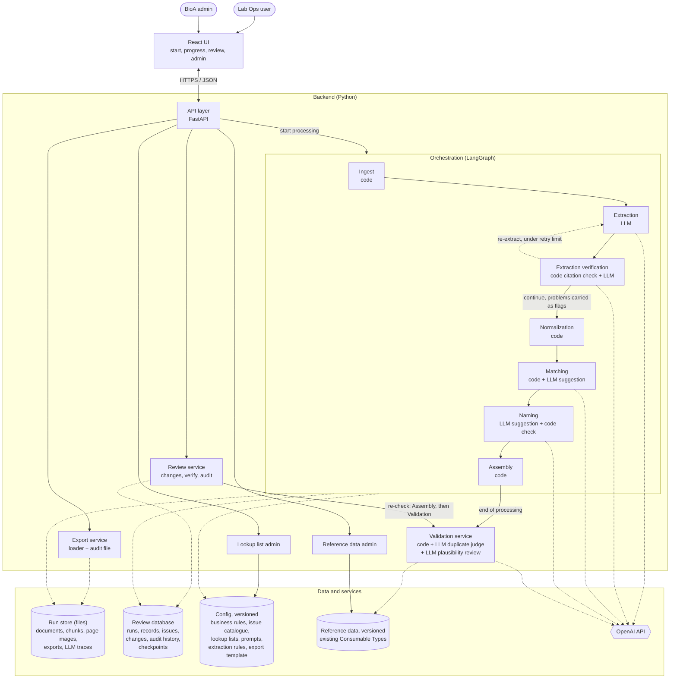
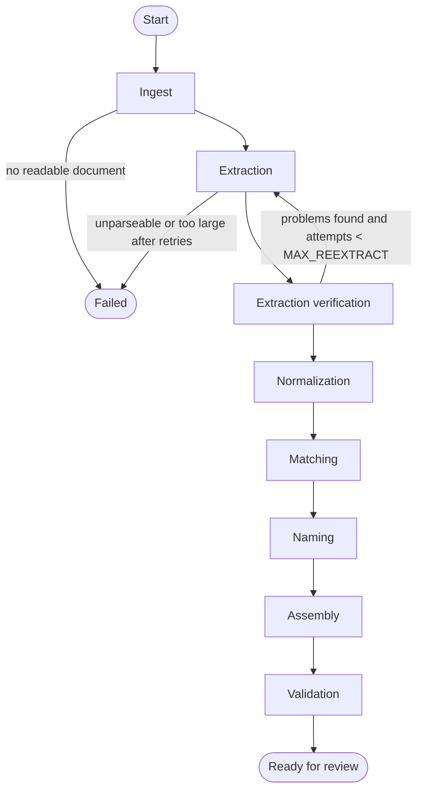

# LabVantage Consumable Type Extractor: Architecture

This document defines the architecture and design of the pilot. Build to it.
How to build it (milestones, order, tests) is for the build plan.

Related documents in this folder:
- `CONTRACTS.md`: every JSON contract and file format, field by field.
- `UI_SPEC.md`: screens, states and review behaviors.
- `ui_mockups/`: UI mockups as static HTML and PNG (reference only; `UI_SPEC.md` wins).
- `../clients/bioa/`: the config files (business rules, extraction rules, export template, issue catalogue, lookup lists, prompts, reference data mapping) and `source/`, BioA's field definitions and lists.

---

## 1. Purpose and boundary

The tool reads BioAgilytix (BioA) source documents, finds candidate Consumable Types, lets a Lab Ops user review and fix them, and exports an Excel file in the format the LabVantage "BAL Consumable Type" Data File Definition (DFD) imports.

- The tool never writes to LabVantage. Its job ends at the filled Excel loader (built from the export template) and audit file.
- QC review and approval happen in LabVantage, not in the tool (SOP §7.9.1).
- The tool covers Consumable Types only (no lots, recipes, worksheets, LES).
- No direct LabVantage connection; reference lists are files.
- Users: Lab Ops (analyst / PM, possibly master data architect). Admin: a BioA admin.
- BioA-specific content stays in `clients/bioa/` so a scrubbed Clarkston copy can be made without it (§10).

## 1a. Glossary

| Term | Meaning here |
|---|---|
| LabVantage | BioA's LIMS (laboratory information management system) |
| Consumable Type | LabVantage master data record describing a kind of material (reagent, buffer, standard, kit…). Not a physical lot. Its name is the primary key and must be unique |
| Consumable Lot / Container | Physical batches and containers of a Consumable Type. Out of scope |
| DFD (Data File Definition) | LabVantage import configuration ("BAL Consumable Type") that reads an Excel file and creates Consumable Types |
| Loader | The Excel file the DFD imports. The tool's main output |
| Lookup list | Allowed values for a field (e.g. Storage Condition), maintained by the BioA admin |
| Reference data | An export of existing Consumable Types, used to catch duplicates |
| Run | One extraction session: one document set, its records, review and exports |
| Record | One candidate Consumable Type in a run |
| Issue | A problem flagged on a record, field or run: red (Fix), yellow (Check), grey (info) |
| Chunk | A labeled piece of a source document; every value cites chunks |
| Business rules | `clients/bioa/business_rules.md`: the fields (their structural facts), their rules and the data tables code reads. The only source of field and business rules, except extraction guidance (`extraction_rules.md`), the loader layout (`export_template.md`) and the naming rules (`prompts/naming.md`) |
| Context attribute | A fact extracted once per record for other rules (`source_heading`, `serial_dilution`). Never exported or displayed |
| Derived field | A loader field Assembly sets from other values using a table in the business rules (Critical, Consumable Class, Approval Type, Worksheet Template) |
| Suggestion | A value a model step (Matching or Naming) proposes for a field. Stored beside the field; never applied until a person uses it |
| Verified | Label a user can put on a run when no red issues remain |
| BAL / BAL-DUR | BioAgilytix Labs / the Durham site (SOP scope) |

## 1b. What the source documents look like

From BioA and the SOP:
- BioA calls them "plans" (study plans) and "methods" (test methods). Word or PDF; supplemental worksheets may be Excel.
- Purchased items are usually listed in the method or plan, often in a reagent table (name, vendor, catalog number, storage, amount).
- Recipes for prepared reagents may appear only on a supplemental worksheet.
- Worksheets may be scanned, sometimes crooked or handwritten.
- Documents vary a lot by project, assay, client and document type. Do not assume one fixed template.
- Serial dilutions (standards, QC samples) appear as several levels; each level is its own Consumable Type (SOP §7.4.3).

## 3. Architecture overview

### 3.1 System diagram

### 3.2 Graph (LangGraph nodes and edges)

Why it looks like this:
- The orchestrator is not a box in the chain. It is LangGraph itself: it holds the processing state, follows the edges, applies routing rules, saves checkpoints, and retries failures. It is drawn as the container around the steps.
- LangGraph runs the processing only, and ends when the run is ready for review. Review (changes, re-checks, Verify, coming back days later) is ordinary application state: the API and a review service keep it in the review database and call the Validation service directly. This avoids tying user edits to graph pause/resume behavior.
- No LLM "orchestrator agent". Every routing decision is a rule. The LLM reports, suggests or judges (inside the agents); code decides *where it goes*, and only code and people write loader values. This keeps runs repeatable, testable and explainable to QC.
- Single-pass extraction. Extraction sits behind one interface: chunks and business rules in, an extraction result (`CONTRACTS.md` §2) out. Nothing else depends on how it works inside, so batched extraction (identify materials, extract per batch, reconcile) can replace it later without changing other components, if real documents show a need.

## 4. Components

Each component: input, what it does, output. Contracts are in `CONTRACTS.md`.

### 4.1 React UI
- **Input:** user actions.
- **Does:** sends requests to the API, shows progress, review grid, admin screens.
- **Output:** HTTP requests. Never calls OpenAI or reads config directly (keys and lists stay on the server).
- Details: `UI_SPEC.md`.

### 4.2 API layer (FastAPI)
- **Input:** requests from the UI.
- **Does:** checks user and role (placeholder in the pilot), saves uploads, starts the graph in the background, calls the review, export and admin services, builds the flattened review view.
- **Output:** JSON to the UI; a start command to the graph.
- No business logic in the API layer.

### 4.3 Orchestration (LangGraph)
- **Does:** runs the nodes in order, applies the routing rules (§5), retries failed calls (per-node retry setting, `LLM_RETRIES`), saves state after each node (SQLite checkpointer in the pilot). When Validation finishes, it writes the records and issues to the review database and the run becomes `in_review`. The graph's work is then done.
- One run = one LangGraph thread; `thread_id` = `run_id`.
- Document contents never go into graph state; only references.
- LangGraph is used without LangChain. Nodes call the OpenAI SDK through a small wrapper.

### 4.4 Ingest (code)
- **Input:** files saved by the API.
- **Does:**
  - Records file name, type, page count, SHA-256 fingerprint.
  - Extracts text and splits it into labeled chunks with stable IDs (`CONTRACTS.md` §1).
  - `.docx`: sections and tables. `.pdf` with text: per page. `.xlsx`: per sheet and row range.
  - PDF pages with no extractable text (scanned) are rendered to PNG and become `page_image` chunks. The image is stored in the run store; the chunk holds a reference, never the image. No OCR.
  - Keeps reagent tables intact (row groups), since they hold most consumable data.
  - Detects an uploaded DFD loader or previous export (by its column headers) and skips it with a run issue.
- **Output:** document list, chunks, run issues.
- Accepted types: `.docx`, `.pdf`, `.xlsx`. Not `.xls` or `.xlsm`. Handwriting is best-effort and always flagged.

### 4.5 Extraction (LLM)
- **Input:** chunks (text chunks as text; `page_image` chunks as images, each labeled with its chunk ID, in the same request); the active rule lines of `extraction_rules.md` (general rules, candidate criteria, fields with role `extracted` or `generated`, context attributes), inserted by the prompt builder with each field's key, column and shape from `business_rules.md`; extraction prompt. On re-extraction: the problems found, for affected records only.
- **Does:** one LLM call per run: finds candidate Consumable Types and copies every extractable field and context attribute whole and as written (including words such as "or equivalent"), with sources. Each gets a status: `found`, `not_found`, `conflicting` or `unclear`.
- **Output:** Extraction JSON (`CONTRACTS.md` §2). Code then assigns permanent `record_id`s.
- Response checked against the schema and status rules; a violation is retried, then fails the step.
- Before calling the LLM, code estimates the input tokens. Over `MAX_INPUT_TOKENS`: the run fails with `DOCUMENT_SET_TOO_LARGE`, without a call.
- If the response is still too long to complete: the run fails with `DOCUMENT_SET_TOO_LARGE`. These failures are the evidence that would justify two-pass extraction.

### 4.6 Extraction verification (code + LLM)
Your "verify the extracted data" step. Two parts in one node:
1. **Citation check (code):** on fields and context attributes. Each evidence quote must appear in its chunk, and the value in at least one quote (case- and whitespace-insensitive). Result per field: `verified`, `not_verified` (yellow `CITATION_NOT_VERIFIED`), `not_checkable` when the source is a `page_image` chunk (yellow `SCANNED_SOURCE`). Catches invented values with believable citations.
2. **Verification agent (LLM):** receives the same text and page images, and checks what code cannot: whether cited text supports the value, whether the value is whole (`incomplete` when cut short), whether `not_found` or `unclear` is right, missed consumables, wrongly excluded items, unreported conflicts, records to split. Reports only problems, each with its `section` (`fields` or `context`). It checks reading only, never plausibility. Stricter prompt than extraction, to counter its tendency to agree.
- **Output:** verification findings (`CONTRACTS.md` §3).

### 4.7 From extracted text to loader values: Normalization, Matching, Naming, Assembly
Four steps turn extracted text into loader values. Models only suggest; code and people write values. Every rule and table comes from `business_rules.md`; each derivation is a small named function that reads its table (no general rules engine).

#### 4.7a Normalization (code)
Per field, in this order; for a conflicting field, per alternative:
1. Clean text: trim, collapse spaces, remove control characters.
2. Translate characters with the character translation table (µ to u, α to alpha, …).
3. Apply the field's translation table. Phrase rows match ignoring case, spaces and the degree sign; range rows match a stated temperature from Min to Max. A "Reviewer chooses" row leaves the value blank and notes the choices.
4. Lookup match in tiers (exact, then unique case-insensitive, then unique ignoring case, spaces and "°"), after removing excluded lookup values. Never creates a list value.
5. Read numbers from text. Never convert units.
6. Classify Target Concentration with the concentration units table: a number followed by a concentration unit gives the number; anything else is left blank with a note.
7. Collect unresolved lookup values of fields with `Matching allowed = yes` for Matching.
- **Output:** the `normalization` section of each field: normalized value or alternatives, and notes.

#### 4.7b Matching (code + LLM)
- De-duplicates the unresolved items by (field, normalized value).
- Code builds each shortlist: the `MATCHING_SHORTLIST_SIZE` most similar list values (difflib), or the whole list when it is that size or smaller; excluded values removed.
- One LLM call per run for the items not in the cache. A choice not on the item's shortlist is rejected.
- **Output:** a `suggestion` on the field (value, reason). The value is not set.

#### 4.7c Naming (LLM + code)
- One LLM call per run for all included records, following the naming rules in `prompts/naming.md`. Cached per record.
- Code checks each suggested name: character translation applied, max length, disallowed characters, unique in the run. A failing suggestion is dropped and the reason kept.
- **Output:** a `suggestion` on the record name field. The name stays empty until a person uses the suggestion or types a name.

Matching, Naming and the plausibility review (§4.8) never fail a run. Their results are cached in the review database (`matching_cache`, `naming_cache`, `plausibility_cache`; keyed by the values, business rules version, prompt version and model). Settings: `MATCHING_MODEL`, `NAMING_MODEL`, `PLAUSIBILITY_MODEL`, `MAX_MATCHING_CALLS`, `MAX_NAMING_CALLS`, `MAX_PLAUSIBILITY_CALLS`, `MATCHING_SHORTLIST_SIZE`; all may be blank. A run captures a blank model as blank. A blank model setting, a reached call limit (`MAX_MATCHING_CALLS`, `MAX_NAMING_CALLS`, `MAX_PLAUSIBILITY_CALLS`) or a call that fails after its retry adds a run-level `_SKIPPED` warning, and the run continues.

#### 4.7d Assembly (code)
1. Closes conflicts whose alternatives are identical after normalization, with a note.
2. Writes each extracted field's loader value from its normalized value, with the normalization notes. Multi-value fields (Catalog No, joined with ", ") are joined by Normalization, because `normalization.value` is one text. A value left for Matching or for a reviewer's choice has no output.
3. Derives, in this order, each from its table: Critical (from `source_heading` and the critical headings table); Consumable Class (from Manufacturer, the BAL vendor names and the class table); Approval Type (approval type table); Worksheet Template (worksheet template table).
4. Applies defaults to empty fields (e.g. Container Tracking Method `i`, Manage Container Inventory Flag `Y`). Never on conflicting fields.
5. Leaves `system` fields (Version, Status) and `blank_for_now` fields (Expiry Based On, Expiry Period, Expiry Period Units) blank; they are exported blank.
6. Records how each value was produced (`origin`): extracted, default, derived, from suggestion, set by a person.
- Never overwrites a value set by a person. A derived field is recomputed on every re-check unless a person set it.
- **Output:** the `output` section of each field.

### 4.8 Validation (code + LLM duplicate judge + LLM plausibility review)
Your "validation" step: reads and categorizes warnings, applies the business rules and DFD knowledge, checks against existing types.
- Field checks: required, type, max length, lookup membership, disallowed characters. `blank_for_now` and `system` fields are skipped.
- Condition groups from `business_rules.md`: Expected Amount + Unit or Expected No of Containers (`CONDITION_UNMET`); amount and unit together (`PAIR_INCOMPLETE`).
- Turns unresolved extraction-verification findings and normalization and assembly notes into issues. A finding on a context attribute is raised on the field named by its `Drives` attribute.
- Name: empty gives red `NAME_NOT_SET` with the Naming suggestion; set names must be unique within the run.
- Existing Consumable Types (reference data):
  - Exact name match: red (`EXISTS_IN_LABVANTAGE`).
  - Normalized match (case, spacing, unit spelling): yellow (`POSSIBLE_DUPLICATE`).
  - Code shortlists up to 10 similar existing types, plus any with the same catalog number. While the name is not set, the suggested name and the name as written are used; the LLM judge decides same / different / unsure: yellow when same or unsure. At most `MAX_DUPLICATE_JUDGE_CALLS` per run; beyond that, run-level yellow `DUPLICATE_CHECK_SKIPPED`.
- Derived-value check: a derived field set by a person that differs from its derivation gives yellow `DERIVED_VALUE_MISMATCH`. A person may set a derived field (CC-06: no vendor means the reviewer sets the class), so derived fields are editable in review.
- Plausibility review (LLM): only when `business_rules.md` has an active `[Plausibility]` check; only on values that passed the field checks; a finding under an unknown check ID is dropped. Findings are yellow `PLAUSIBILITY_CHECK`. Cached per record.
- Computes each record's Action needed (Fix / Check / None / Excluded).
- **Output:** issues and record status. Never changes values.
- A plain Python service. The graph calls it once at the end of processing; the review service calls it on re-check and on Verify.
- Duplicate-judge results are cached by the fields flagged "Sent to duplicate judge" in `business_rules.md`, the reference data version and the prompt version. Re-checks call the LLM only when one of those changed.

### 4.9 Review service (code, outside the graph)
- Holds the review lifecycle in the review database: records, user changes, issues, audit history. A run can stay in review for as long as needed.
- Saves the user's changes (edits, picked alternatives, used suggestions, accepted warnings, exclusions, bulk changes, undo) into the `output` sections and the edit log, as pending until re-check.
- Re-check: runs Assembly (§4.7d) on the current values, then the Validation service, and stores the new issues. Derived fields are recomputed unless a person set them. Re-check never calls Extraction, Verification, Matching or Naming.
- Verify: re-checks, then sets the **verified** label (who, when) if no red issues and no open individual-review warnings remain. Otherwise the run stays unverified and the UI shows the blockers.
- Any later change removes the verified label.

### 4.10 Export service (on request, outside the graph)
- Export is allowed at any time. Unverified exports are drafts.
- Before writing, re-checks if a change was saved since the last validation. The run keeps the config versions it started with; admin updates do not apply to it.
- Writes two files:
  - The DFD loader, built from `export_template.md` alone: sheet name, header style, frozen row, and the columns in its order with their type and display format; `output.value` only, written unchanged (a format never rounds a value); excluded records left out.
  - The audit workbook (`CONTRACTS.md` §8).
- File names: `[run name] – export [n].xlsx` and `[run name] – export [n] – audit.xlsx`; draft exports add "– draft".

### 4.11 Lookup list admin (on request)
Flow: download current workbook → edit offline in Excel → upload → checks + diff → admin applies ("Apply updates as vN") → current version. Previous versions kept; "Restore" any version.
- Admins edit values only. Fields (which columns exist and their rules) are developer-maintained config.
- Admin can add, change and delete values on any sheet, and add new sheets (stored, unused until a developer connects a field).
- New lookup versions apply to new runs only.
- Admin cannot remove or rename a sheet a field uses (upload rejected with the field name).
- Upload checks: expected sheets present, header `Lookup Value`, no blank rows, no leading/trailing spaces or control characters, no case-only duplicates, max length per field, `_metadata.version_id` equals the current version (stale uploads rejected).
- Every upload, apply and restore is logged (who, when, what changed).

### 4.12 Reference data admin (on request)
- Admin uploads an export of existing Consumable Types (`.xlsx` or `.csv`). Columns mapped by `reference_data_mapping.yaml` (defaults from the column layout of a LabVantage export). Stored as a versioned snapshot. The UI shows the date in use.

### 4.13 Data and services

| Store | Holds | Written by |
|---|---|---|
| Config (`clients/bioa/`) | Business rules, extraction rules, export template, issue catalogue, lookup lists, prompts, reference mapping | Developers; lookup lists by the admin |
| Reference data | Existing Consumable Types snapshots | Admin |
| Run store (files) | Documents, chunks, page images, exports, LLM requests and responses | Graph, API, export service |
| Review database (SQLite in the pilot) | Runs, records, issues, changes, audit history; LangGraph checkpoints | Graph (writes at the end of processing), review service, API |
| OpenAI API | External LLM | n/a |

## 5. Routing rules

| From | To | Rule |
|---|---|---|
| Ingest | Failed | No document is readable |
| Extraction | Failed | Response unparseable or too long after `LLM_RETRIES` |
| Extraction verification | Extraction | Any of: field verdict `contradicted`, `unsupported`, `present_missed` or `incomplete` (on fields or context attributes); citation `not_verified`; `missed_candidates`; `unreported_conflicts`; record verdict `should_be_split` — **and** attempts < `MAX_REEXTRACT` (default 1). Status `unclear` alone does not trigger it. Re-extraction covers affected records and missed candidates only |
| Extraction verification | Normalization | Otherwise. Unresolved findings become issues |
| Normalization | Matching | Always (Matching makes no call when there are no items) |
| Matching | Naming | Always, also when Matching was skipped |
| Naming | Assembly | Always, also when Naming was skipped |
| Assembly | Validation | Always |
| Validation | End (ready for review) | Always. Records and issues are written to the review database |

After the graph ends, the review service calls the Validation service directly on re-check (user moves to another record, bulk action, exclude or restore) and on Verify. A save alone stores changes as pending (UI_SPEC §4.3).

Retries for timeouts and rate limits are a node setting, not an edge. Routing lives only in `backend/app/graph/routing.py`; nodes never call each other.

## 6. Run lifecycle

- Status values: `created → ingesting → extracting → verifying_extraction → normalizing → matching → naming → assembling → validating → in_review`, then `rechecking ↔ in_review` (review service, not the graph); or `failed`.
- A failed run is kept as is. Retry starts a new run from the same uploaded files, linked by `retry_of`.
- A run uses the config versions captured at its start for its whole life (business rules, extraction rules, export template, issue catalogue, lookup lists, reference mapping, prompts), and the models captured at its start (extraction, verification, matching, naming, plausibility, duplicate judge).
- Verified label: separate from status (yes/no, by, at). Removed by any later change.
- Exports: numbered list, each draft or verified, each with loader and audit file.
- Runs are saved and never lost; users can leave and return.
- Each run has a user-editable name, pre-filled from the first file name and date.

## 7. Data rules that apply everywhere

- **Never fabricate a value.** Missing stays missing and raises an issue.
- **Every record shows where it was found** (`found_in`), and every value keeps its own sources.
- **Layers write only their own section** of the stored record; earlier sections are read-only. Export reads only `output.value`.
- **Multiple values for one field:** conflicts between sources and two named products are `conflicting`; one product "or equivalent" is `found` and copied whole, words included. Exception: several catalog numbers for one item are allowed in Catalog No, joined with ", ".
- **Different items are different records** (stock vs working solution, each serial dilution level).
- **A model reports, suggests or judges; it never writes a loader value.** Only code and people write values. A suggestion is applied only when a person uses it. A value set by a person is never overwritten.
- **Each step writes only its own section. Only Validation creates issues, and it never changes a value.**
- **The LLM produces facts; code applies rules.** If a rule needs a judgment-based input, that input is extracted (e.g. a context attribute); the rule itself is code.
- **No general rules engine.** Values come only from the documents, the user, and code applying the tables and defaults in `business_rules.md` and the lookup lists. Each derivation is a small named function.
- **Field definitions and rules come only from `business_rules.md`.** A rule or table row with status `Open` is inactive: not inserted into prompts, ignored by code. Where `business_rules.md` differs from BioA's source workbook (`clients/bioa/source/`), the consistency test lists the difference with the rule ID that explains it.

## 8. Configuration

All BioA-specific content lives in `clients/bioa/` (loaded via `CLIENT_CONFIG_DIR`). All deployment settings live in environment variables (`env.example`).

| File | Purpose | Owner |
|---|---|---|
| `business_rules.md` | The 22 loader fields and 2 context attributes (role, requirement, type, length, lookup, default, flags); rule lines tagged by code step, `[Matching]` and `[Plausibility]`; data tables (translations, derivations, condition groups, excluded lookup values) | Developers, from BioA's answers |
| `extraction_rules.md` | Extraction guidance: general extraction rules, candidate criteria, and the `[Extraction]` lines of each extracted field and context attribute | Developers, from BioA's answers |
| `export_template.md` | Loader layout: sheet settings, and the 22 columns in export order with type and display format. The only source of column order | Developers |
| `issue_catalogue.yaml` | Issue codes, severities, messages | Developers |
| `lookup_lists.xlsx` | One sheet per lookup field | BioA admin (via the app) |
| `reference_data_mapping.yaml` | Column mapping for existing-types uploads | Developers |
| `prompts/*.md` | Prompt templates, versioned | Developers |

The field list is locked but flexible: adding, removing or reordering a field is a config change plus a version bump. Schema, prompts, grid, validation and export all follow `business_rules.md`, in the column order of `export_template.md`; startup checks keep the two files' columns and types in step. What still needs a person when fields change: eval labels, and the code and test behind a rule tagged for a code step.

Prompt files never contain BioA rules. The prompt builder inserts the active rule lines for each model step (`[Extraction]` from `extraction_rules.md`; `[Matching]` and `[Plausibility]` from `business_rules.md`) with their IDs, without status and source. One exception: style guidance read whole by one prompt and never looked up by rule ID may live in that prompt. Today that is only the naming rules in `prompts/naming.md` (Open ones kept in a developer note).

Config files are validated at startup; the app refuses to start if `business_rules.md` is missing or malformed. Each run records the versions it used.

## 9. Evaluation and logging foundations

Build the capability now; there is no real test data yet.

Foundations built in from the start:
1. IDs everywhere: `run_id`, node, attempt on every log line, LLM call and audit entry.
2. Versions everywhere: models, prompts, business rules, issue catalogue, lookup lists, reference data, per run.
3. Every LLM request and response saved in the run store from the first run.
4. Evals run the same graph the app runs.

Three kinds of record, kept separate:

| Kind | Purpose | Where |
|---|---|---|
| Application logs | Debugging, operations | Structured JSON lines (console) |
| Audit trail | Business record of changes, verification, exports, admin actions | Run store; feeds the audit file |
| LLM traces | Prompt debugging and evals | Run store |

- Logs contain only IDs, counts and durations. No document text, no field values.
- LangGraph state holds records, issues and references; never document text or page images (those stay in the run store).
- The edit log doubles as a quality signal (which fields users correct most).
- Eval levels: unit tests, plus a harness for step and end-to-end evals. Eval cases are added as labeled documents become available.
- Config consistency test: `business_rules.md` (field list, order, type, requirement, character limits, list/boolean input, defaults) and the seed `lookup_lists.xlsx` must match `clients/bioa/source/BAL_Consumable_Type_Definitions.xlsx`. Allowed differences are listed in the test, each citing the rule ID in `business_rules.md` that explains it. Admin-uploaded lookup versions are not checked against it.
- Rule traceability test: every active rule tagged for a code step is named by at least one test (`rule` pytest marker).
- Formats: `CONTRACTS.md` §9–§11; `evals/README.md`.
- **Fake-LLM tests prove the plumbing, not AI quality.** Passing tests with the fake LLM shows orchestration, contracts, validation and export work. It says nothing about how accurately the real model extracts. That needs BioA documents with human-labeled expected results, including hard documents and negative cases, run against the real provider . Until then, extraction quality is unverified, and no loader is assumed safe for production import because mock validation passes.

## 9a. Security boundaries (pilot)

- The pilot runs locally or in an isolated environment only. It is never deployed publicly: sign-in is a placeholder, so uploaded documents and admin endpoints would be open.
- Uploads: only `.docx`, `.pdf`, `.xlsx` (no macro-enabled files), size limited by `MAX_FILE_SIZE_MB` and `MAX_FILES_PER_RUN`; files are stored, never executed.
- Document text is untrusted: prompts tell the model the documents are data, not instructions; LLM output is parsed against a schema and never executed.
- LLM prompts and responses (including page images) are kept in the run store. Retention is a setting (`LLM_TRACE_RETENTION_DAYS`); the pilot keeps everything because its data is synthetic. Production retention is BioA IT's decision.
- `clients/bioa/` is never copied into the scrubbed Clarkston repository (§10).

## 10. Separation for the scrubbed Clarkston copy

- `backend/` and `frontend/` contain no BioA field names, values, prompts or rules as literals.
- Everything BioA-specific is in `clients/bioa/`.
- A test checks that no file under `backend/` contains values from the client lookup lists or the tables in `business_rules.md`.
- Real BioA eval cases live only in the BioA environment.

## 11. Technology

| Area | Choice |
|---|---|
| Front end | React + TypeScript (Vite) |
| Back end | Python 3.12, FastAPI, Pydantic v2, openpyxl, pytest; `uv` for dependencies |
| Orchestration | LangGraph (without LangChain), SQLite checkpointer. SQLite and FastAPI background tasks are pilot infrastructure, not durable production processing |
| LLM | OpenAI SDK; key and models are settings |
| Code quality | ruff (format + lint, docstring rules on), pyright |
| Tracing | No external tracing service |
