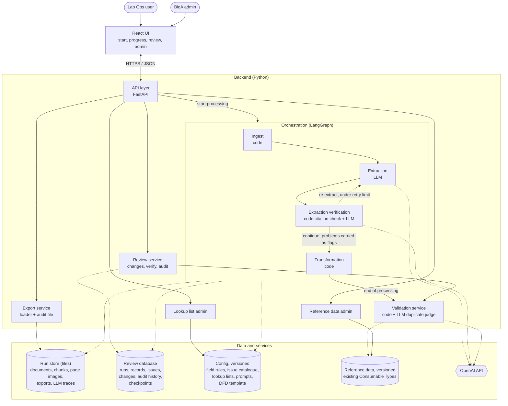
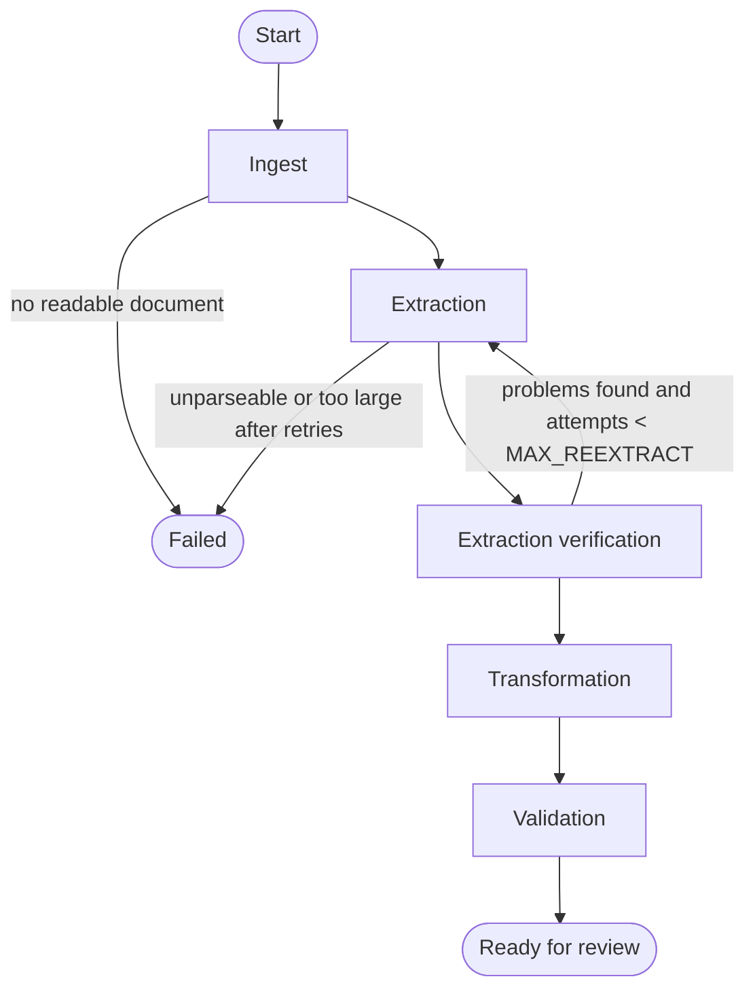

# LabVantage Consumable Type Extractor: Architecture

This document defines the architecture and design of the pilot. Build to it.
How to build it (milestones, order, tests) is for the build plan.

Related documents in this folder:
- `CONTRACTS.md`: every JSON contract and file format, field by field.
- `UI_SPEC.md`: screens, states and review behaviors.
- `ui_mockups/`: UI mockups as static HTML and PNG (reference only; `UI_SPEC.md` wins).
- `diagrams/`: PNG and SVG renders of the Mermaid diagrams in §3. The Mermaid source here is the master.
- `../clients/bioa/`: the config files (field rules, issue catalogue, lookup lists, DFD template, prompts, reference data mapping) and `source/`, BioA's field definitions and lists.

---

## 1. Purpose and boundary

The tool reads BioAgilytix (BioA) source documents, finds candidate Consumable Types, lets a Lab Ops user review and fix them, and exports an Excel file in the format the LabVantage "BAL Consumable Type" Data File Definition (DFD) imports.

- The tool never writes to LabVantage. Its job ends at the filled Excel loader (DFD template) and audit file.
- QC review and approval happen in LabVantage, not in the tool (SOP §7.9.1).
- The tool covers Consumable Types only (no lots, recipes, worksheets, LES).
- No direct LabVantage connection; reference lists are files.
- Users: Lab Ops (analyst / PM, possibly master data architect). Admin: a BioA admin.
- BioA-specific content stays in `clients/bioa/` so a scrubbed Clarkston copy can be made without it (§10).

## 1a. Glossary

| Term | Meaning here |
|---|---|
| LabVantage | BioA's LIMS (laboratory information management system) |
| Consumable Type | LabVantage master data record describing a kind of material (reagent, buffer, standard, kit…). Not a physical lot. Its name is the primary key and must be unique |
| Consumable Lot / Container | Physical batches and containers of a Consumable Type. Out of scope |
| DFD (Data File Definition) | LabVantage import configuration ("BAL Consumable Type") that reads an Excel file and creates Consumable Types |
| Loader | The Excel file the DFD imports. The tool's main output |
| Lookup list | Allowed values for a field (e.g. Storage Condition), maintained by the BioA admin |
| Reference data | An export of existing Consumable Types, used to catch duplicates |
| Run | One extraction session: one document set, its records, review and exports |
| Record | One candidate Consumable Type in a run |
| Issue | A problem flagged on a record, field or run: red (Fix), yellow (Check), grey (info) |
| Chunk | A labeled piece of a source document; every value cites chunks |
| Verified | Label a user can put on a run when no red issues remain |
| BAL / BAL-DUR | BioAgilytix Labs / the Durham site (SOP scope) |

## 1b. What the source documents look like

From BioA and the SOP:
- BioA calls them "plans" (study plans) and "methods" (test methods). Word or PDF; supplemental worksheets may be Excel.
- Purchased items are usually listed in the method or plan, often in a reagent table (name, vendor, catalog number, storage, amount).
- Recipes for prepared reagents may appear only on a supplemental worksheet.
- Worksheets may be scanned, sometimes crooked or handwritten.
- Documents vary a lot by project, assay, client and document type. Do not assume one fixed template.
- Serial dilutions (standards, QC samples) appear as several levels; each level is its own Consumable Type (SOP §7.4.3).

## 3. Architecture overview

### 3.1 System diagram

### 3.2 Graph (LangGraph nodes and edges)

Why it looks like this:
- The orchestrator is not a box in the chain. It is LangGraph itself: it holds the processing state, follows the edges, applies routing rules, saves checkpoints, and retries failures. It is drawn as the container around the steps.
- LangGraph runs the processing only, and ends when the run is ready for review. Review (changes, re-checks, Verify, coming back days later) is ordinary application state: the API and a review service keep it in the review database and call the Validation service directly. This avoids tying user edits to graph pause/resume behavior.
- No LLM "orchestrator agent". Every routing decision is a rule. The LLM decides *what is wrong* (inside the agents); code decides *where it goes*. This keeps runs repeatable, testable and explainable to QC.
- Single-pass extraction. Extraction sits behind one interface: chunks and field rules in, an extraction result (`CONTRACTS.md` §2) out. Nothing else depends on how it works inside, so batched extraction (identify materials, extract per batch, reconcile) can replace it later without changing other components, if real documents show a need.

## 4. Components

Each component: input, what it does, output. Contracts are in `CONTRACTS.md`.

### 4.1 React UI
- **Input:** user actions.
- **Does:** sends requests to the API, shows progress, review grid, admin screens.
- **Output:** HTTP requests. Never calls OpenAI or reads config directly (keys and lists stay on the server).
- Details: `UI_SPEC.md`.

### 4.2 API layer (FastAPI)
- **Input:** requests from the UI.
- **Does:** checks user and role (placeholder in the pilot), saves uploads, starts the graph in the background, calls the review, export and admin services, builds the flattened review view.
- **Output:** JSON to the UI; a start command to the graph.
- No business logic in the API layer.

### 4.3 Orchestration (LangGraph)
- **Does:** runs the nodes in order, applies the routing rules (§5), retries failed calls (per-node retry setting, `LLM_RETRIES`), saves state after each node (SQLite checkpointer in the pilot). When Validation finishes, it writes the records and issues to the review database and the run becomes `in_review`. The graph's work is then done.
- One run = one LangGraph thread; `thread_id` = `run_id`.
- Document contents never go into graph state; only references.
- LangGraph is used without LangChain. Nodes call the OpenAI SDK through a small wrapper.

### 4.4 Ingest (code)
- **Input:** files saved by the API.
- **Does:**
  - Records file name, type, page count, SHA-256 fingerprint.
  - Extracts text and splits it into labeled chunks with stable IDs (`CONTRACTS.md` §1).
  - `.docx`: sections and tables. `.pdf` with text: per page. `.xlsx`: per sheet and row range.
  - PDF pages with no extractable text (scanned) are rendered to PNG and become `page_image` chunks. The image is stored in the run store; the chunk holds a reference, never the image. No OCR.
  - Keeps reagent tables intact (row groups), since they hold most consumable data.
  - Detects an uploaded DFD loader or previous export (by its column headers) and skips it with a run issue.
- **Output:** document list, chunks, run issues.
- Accepted types: `.docx`, `.pdf`, `.xlsx`. Not `.xls` or `.xlsm`. Handwriting is best-effort and always flagged.

### 4.5 Extraction (LLM)
- **Input:** chunks (text chunks as text; `page_image` chunks as images, each labeled with its chunk ID, in the same request); field rules (only `extracted` fields); extraction prompt. On re-extraction: the problems found, for affected records only.
- **Does:** one LLM call per run: finds candidate Consumable Types and extracts every extractable field, with sources.
- **Output:** Extraction JSON (`CONTRACTS.md` §2). Code then assigns permanent `record_id`s.
- Response checked against the schema and status rules; a violation is retried, then fails the step.
- Before calling the LLM, code estimates the input tokens. Over `MAX_INPUT_TOKENS`: the run fails with `DOCUMENT_SET_TOO_LARGE`, without a call.
- If the response is still too long to complete: the run fails with `DOCUMENT_SET_TOO_LARGE`. These failures are the evidence that would justify two-pass extraction.

### 4.6 Extraction verification (code + LLM)
Your "verify the extracted data" step. Two parts in one node:
1. **Citation check (code):** each evidence quote must appear in its chunk, and the value in at least one quote (case- and whitespace-insensitive). Result per field: `verified`, `not_verified` (yellow `CITATION_NOT_VERIFIED`), `not_checkable` when the source is a `page_image` chunk (yellow `SCANNED_SOURCE`). Catches invented values with believable citations.
2. **Verification agent (LLM):** receives the same text and page images, and checks what code cannot: whether cited text supports the value, whether `not_found` is truly absent, missed consumables, wrongly excluded items, unreported conflicts, records to split. Reports only problems. Stricter prompt than extraction, to counter its tendency to agree.
- **Output:** verification findings (`CONTRACTS.md` §3).

### 4.7 Transformation (code)
Converts extracted data into loader-ready format. No LLM calls.
- Trims and collapses whitespace, removes control characters.
- Converts types (numbers stay exactly as written if they cannot be converted; validation flags them).
- Matches lookup values exactly; fixes case or spacing only when exactly one case-insensitive match exists.
- Joins multiple catalog numbers with ", " (Catalog No only).
- Applies `default` values to fields still empty (e.g. Container Tracking Method = Individual, Manage Container Inventory Flag = Yes).
- Matches list fields to the lookup list, ignoring case, spaces and "°"; no match is a red `NOT_IN_LOOKUP` issue for the user to resolve.
- Reads numbers from text ("1e4 cps/uL" → 10000) and joins catalog numbers with ", ".
- Leaves `blank_for_now` fields empty (Approval Type, Consumable Params, Worksheet Template); they are exported blank. The API returns the placeholder "TEST VALUE" as their display value so the UI shows it. Leaves `system` fields empty (Version, Status; "System Generated" in Data info).
- Never overwrites a value from the documents or the user. Only fills empty fields.
- **Output:** the `output` section of each field, with `origin`.

### 4.8 Validation (code + LLM duplicate judge)
Your "validation" step: reads and categorizes warnings, applies field rules and DFD knowledge, checks against existing types.
- Field checks: required, type, max length, lookup membership, disallowed characters. `blank_for_now` and `system` fields are skipped.
- Condition groups from `field_rules.yaml`: Expected Amount + Unit or Expected No of Containers (`CONDITION_UNMET`); amount and unit together (`PAIR_INCOMPLETE`).
- Turns unresolved extraction-verification findings into issues.
- Name unique within the run.
- Existing Consumable Types (reference data):
  - Exact name match: red (`EXISTS_IN_LABVANTAGE`).
  - Normalized match (case, spacing, unit spelling): yellow (`POSSIBLE_DUPLICATE`).
  - Code shortlists up to 10 similar existing types; the LLM judge decides same / different / unsure: yellow when same or unsure. At most `MAX_DUPLICATE_JUDGE_CALLS` per run; beyond that, run-level yellow `DUPLICATE_CHECK_SKIPPED`.
- "Or equivalent" (`allows_equivalent`): one yellow `OR_EQUIVALENT` per record.
- Computes each record's Action needed (Fix / Check / None / Excluded).
- **Output:** issues and record status. Never changes values.
- A plain Python service. The graph calls it once at the end of processing; the review service calls it on re-check and on Verify.
- Duplicate-judge results are cached by the record's identifying fields (name, description, class, manufacturer, catalog number, target concentration), the reference data version and the prompt version. Re-checks call the LLM only when one of those changed.

### 4.9 Review service (code, outside the graph)
- Holds the review lifecycle in the review database: records, user changes, issues, audit history. A run can stay in review for as long as needed.
- Saves the user's changes (edits, picked alternatives, accepted warnings, exclusions, bulk changes, undo) into the `output` sections and the edit log, as pending until re-check.
- Re-check: calls the Validation service on the run's records and stores the new issues.
- Verify: re-checks, then sets the **verified** label (who, when) if no red issues and no open individual-review warnings remain. Otherwise the run stays unverified and the UI shows the blockers.
- Any later change removes the verified label.

### 4.10 Export service (on request, outside the graph)
- Export is allowed at any time. Unverified exports are drafts.
- Before writing, re-checks if a change was saved since the last validation. The run keeps the config versions it started with; admin updates do not apply to it.
- Writes two files:
  - The DFD loader from `dfd_template.xlsx` (`Sheet1`, 22 columns, `output.value` only, excluded records left out).
  - The audit workbook (`CONTRACTS.md` §8).
- File names: `[run name] – export [n].xlsx` and `[run name] – export [n] – audit.xlsx`; draft exports add "– draft".

### 4.11 Lookup list admin (on request)
Flow: download current workbook → edit offline in Excel → upload → checks + diff → admin applies ("Apply updates as vN") → current version. Previous versions kept; "Restore" any version.
- Admins edit values only. Fields (which columns exist and their rules) are developer-maintained config.
- Admin can add, change and delete values on any sheet, and add new sheets (stored, unused until a developer connects a field).
- New lookup versions apply to new runs only.
- Admin cannot remove or rename a sheet a field uses (upload rejected with the field name).
- Upload checks: expected sheets present, header `Lookup Value`, no blank rows, no leading/trailing spaces or control characters, no case-only duplicates, max length per field, `_metadata.version_id` equals the current version (stale uploads rejected).
- Every upload, apply and restore is logged (who, when, what changed).

### 4.12 Reference data admin (on request)
- Admin uploads an export of existing Consumable Types (`.xlsx` or `.csv`). Columns mapped by `reference_data_mapping.yaml` (defaults from the column layout of a LabVantage export). Stored as a versioned snapshot. The UI shows the date in use.

### 4.13 Data and services

| Store | Holds | Written by |
|---|---|---|
| Config (`clients/bioa/`) | Field rules, issue catalogue, lookup lists, prompts, DFD template, reference mapping | Developers; lookup lists by the admin |
| Reference data | Existing Consumable Types snapshots | Admin |
| Run store (files) | Documents, chunks, page images, exports, LLM requests and responses | Graph, API, export service |
| Review database (SQLite in the pilot) | Runs, records, issues, changes, audit history; LangGraph checkpoints | Graph (writes at the end of processing), review service, API |
| OpenAI API | External LLM | n/a |

## 5. Routing rules

| From | To | Rule |
|---|---|---|
| Ingest | Failed | No document is readable |
| Extraction | Failed | Response unparseable or too long after `LLM_RETRIES` |
| Extraction verification | Extraction | Any of: field verdict `contradicted`, `unsupported` or `present_missed`; citation `not_verified`; `missed_candidates`; `unreported_conflicts`; record verdict `should_be_split` — **and** attempts < `MAX_REEXTRACT` (default 1). Re-extraction covers affected records and missed candidates only |
| Extraction verification | Transformation | Otherwise. Unresolved findings become issues |
| Transformation | Validation | Always |
| Validation | End (ready for review) | Always. Records and issues are written to the review database |

After the graph ends, the review service calls the Validation service directly on re-check (user moves to another record, bulk action, exclude or restore) and on Verify. A save alone stores changes as pending (UI_SPEC §4.3).

Retries for timeouts and rate limits are a node setting, not an edge.

## 6. Run lifecycle

- Status values: `created → ingesting → extracting → verifying_extraction → transforming → validating → in_review`, then `rechecking ↔ in_review` (review service, not the graph); or `failed`.
- A failed run is kept as is. Retry starts a new run from the same uploaded files, linked by `retry_of`.
- A run uses the config versions captured at its start for its whole life.
- Verified label: separate from status (yes/no, by, at). Removed by any later change.
- Exports: numbered list, each draft or verified, each with loader and audit file.
- Runs are saved and never lost; users can leave and return.
- Each run has a user-editable name, pre-filled from the first file name and date.

## 7. Data rules that apply everywhere

- **Never fabricate a value.** Missing stays missing and raises an issue.
- **Every record shows where it was found** (`found_in`), and every value keeps its own sources.
- **Layers write only their own section** of the stored record; earlier sections are read-only. Export reads only `output.value`.
- **Multiple values for one field:** conflicts between sources and two named products are `conflicting`; one product "or equivalent" is found with a yellow `OR_EQUIVALENT`. Exception: several catalog numbers for one item are allowed in Catalog No, joined with ", ".
- **Different items are different records** (stock vs working solution, each serial dilution level).
- **The LLM produces facts; code applies rules.** If a future rule needs a judgment-based input, that input is extracted; the rule itself is code.
- **No business rules engine.** Values come only from the documents, the user, defaults in `field_rules.yaml`, and the lookup lists.
- **Field definitions and values come only from BioA's workbook (`clients/bioa/source/`)** (Data info + List Values). Critical and Manage Container Inventory Flag are Y/N. Where the workbook disagrees with itself (Container Tracking Method: 1-character limit, default "Individual"), the tool follows it literally and flags the issue; BioA edits the workbook.

## 8. Configuration

All BioA-specific content lives in `clients/bioa/` (loaded via `CLIENT_CONFIG_DIR`). All deployment settings live in environment variables (`env.example`).

| File | Purpose | Owner |
|---|---|---|
| `field_rules.yaml` | The 22 fields: role, requirement, type, length, lookup, defaults, guidance | Developers |
| `issue_catalogue.yaml` | Issue codes, severities, messages | Developers |
| `lookup_lists.xlsx` | One sheet per lookup field | BioA admin (via the app) |
| `dfd_template.xlsx` | Loader layout: `Sheet1`, 22 headers | Developers |
| `reference_data_mapping.yaml` | Column mapping for existing-types uploads | Developers |
| `prompts/*.md` | Prompt templates, versioned | Developers |

The field list is locked but flexible: adding, removing or reordering a field is a config change plus a version bump. Schema, prompt, grid, validation and export all follow `field_rules.yaml`. What still needs a person when fields change: eval labels and extraction guidance.

Config files are validated at startup. Each run records the versions it used.

## 9. Evaluation and logging foundations

Build the capability now; there is no real test data yet.

Foundations built in from the start:
1. IDs everywhere: `run_id`, node, attempt on every log line, LLM call and audit entry.
2. Versions everywhere: model, prompts, field rules, issue catalogue, lookup lists, reference data, per run.
3. Every LLM request and response saved in the run store from the first run.
4. Evals run the same graph the app runs.

Three kinds of record, kept separate:

| Kind | Purpose | Where |
|---|---|---|
| Application logs | Debugging, operations | Structured JSON lines (console) |
| Audit trail | Business record of changes, verification, exports, admin actions | Run store; feeds the audit file |
| LLM traces | Prompt debugging and evals | Run store |

- Logs contain only IDs, counts and durations. No document text, no field values.
- LangGraph state holds records, issues and references; never document text or page images (those stay in the run store).
- The edit log doubles as a quality signal (which fields users correct most).
- Eval levels: unit tests, plus a harness for step and end-to-end evals. Eval cases are added as labeled documents become available.
- Config consistency test: `field_rules.yaml` (field list, order, type, requirement, character limits, list/boolean input, defaults) and the seed `lookup_lists.xlsx` must match `clients/bioa/source/BAL_Consumable_Type_Definitions.xlsx`. Allowed differences are listed in the test with their reason (e.g. Approval Type, Consumable Params, Worksheet Template are `blank_for_now`). Admin-uploaded lookup versions are not checked against it.
- Formats: `CONTRACTS.md` §9–§11; `evals/README.md`.
- **Fake-LLM tests prove the plumbing, not AI quality.** Passing tests with the fake LLM shows orchestration, contracts, validation and export work. It says nothing about how accurately the real model extracts. That needs BioA documents with human-labeled expected results, including hard documents and negative cases, run against the real provider . Until then, extraction quality is unverified, and no loader is assumed safe for production import because mock validation passes.

## 9a. Security boundaries (pilot)

- The pilot runs locally or in an isolated environment only. It is never deployed publicly: sign-in is a placeholder, so uploaded documents and admin endpoints would be open.
- Uploads: only `.docx`, `.pdf`, `.xlsx` (no macro-enabled files), size limited by `MAX_FILE_SIZE_MB` and `MAX_FILES_PER_RUN`; files are stored, never executed.
- Document text is untrusted: prompts tell the model the documents are data, not instructions; LLM output is parsed against a schema and never executed.
- LLM prompts and responses (including page images) are kept in the run store. Retention is a setting (`LLM_TRACE_RETENTION_DAYS`); the pilot keeps everything because its data is synthetic. Production retention is BioA IT's decision.
- `clients/bioa/` is never copied into the scrubbed Clarkston repository (§10).

## 10. Separation for the scrubbed Clarkston copy

- `backend/` and `frontend/` contain no BioA field names, values, prompts or rules as literals.
- Everything BioA-specific is in `clients/bioa/`.
- A test checks that no file under `backend/` contains values from the client lookup lists.
- Real BioA eval cases live only in the BioA environment.

## 11. Technology

| Area | Choice |
|---|---|
| Front end | React + TypeScript (Vite) |
| Back end | Python 3.12, FastAPI, Pydantic v2, openpyxl, pytest; `uv` for dependencies |
| Orchestration | LangGraph (without LangChain), SQLite checkpointer. SQLite and FastAPI background tasks are pilot infrastructure, not durable production processing |
| LLM | OpenAI SDK; key and models are settings |
| Code quality | ruff (format + lint, docstring rules on), pyright |
| Tracing | No external tracing service |
